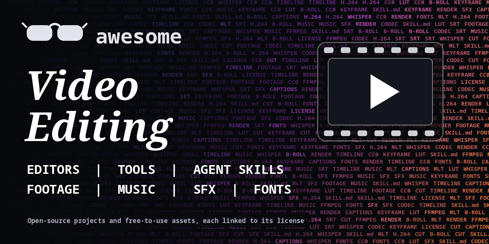

<h1 align="center">Awesome Video Editing</h1>

> One library for video editing: open-source editors and tools, agent skills, and free sources for footage, music, sound effects, fonts and graphics. Every entry links to its license.

**Part 1** covers software you can run yourself. **Part 2** covers assets you can put in a video. Software entries are public GitHub repos. Asset entries are websites, each with the license it states.

**Rules of this list:** every repo exists, is public, is not archived and has had a commit in the last year. Every asset source is open and states how its content may be used. One plain sentence each. No copied text from other lists. Asset licenses can change and can differ per file, so read the license on the exact file before you publish. Checked 2026-10-18. See [CONTRIBUTING.md](CONTRIBUTING.md).

## Contents

**Part 1: Software and skills**

- [Video editors](#video-editors)
- [Make video with code](#make-video-with-code)
- [Agent skills for video](#agent-skills-for-video)
- [Captions, transcription and voice](#captions-transcription-and-voice)
- [Audio editing and music making](#audio-editing-and-music-making)
- [Enhance, cut out and analyze footage](#enhance-cut-out-and-analyze-footage)
- [Convert, compress and process](#convert-compress-and-process)
- [Screen recording](#screen-recording)
- [Compositing and 3D](#compositing-and-3d)
- [Animation libraries](#animation-libraries)
- [Video generation models and tools](#video-generation-models-and-tools)
- [Other awesome lists](#other-awesome-lists)

**Part 2: Assets**

- [Stock footage and archives](#stock-footage-and-archives)
- [Music](#music)
- [Sound effects](#sound-effects)
- [Fonts](#fonts)
- [Icons, illustrations and Lottie](#icons-illustrations-and-lottie)
- [Textures, HDRIs and 3D](#textures-hdris-and-3d)
- [Editing templates](#editing-templates)

- [Using assets safely](#using-assets-safely)
- [How to choose software](#how-to-choose-software)
- [Contributing](#contributing)

# Part 1: Software and skills

## Video editors

Full editors you install and use, from classic timelines to chat-driven tools.

- [0xsline/OpenChatCut](https://github.com/0xsline/OpenChatCut)  - Local-first video editor with a multi-track timeline that you can drive by chat. Ships agent skills. _(AGPL-3.0)_
- [AIEraDev/Clypra](https://github.com/AIEraDev/Clypra)  - Hardware-accelerated desktop editor built with Rust, Tauri and React. _(MIT)_
- [jliljebl/flowblade](https://github.com/jliljebl/flowblade)  - Multitrack non-linear editor for Linux, built on MLT. _(GPL-3.0)_
- [KDE/kdenlive](https://github.com/KDE/kdenlive)  - Free desktop editor from KDE, built on MLT. Multi-track timeline, proxies, effects. _(GPL-3.0)_
- [krillinai/OpenCreator](https://github.com/krillinai/OpenCreator)  - Video translation and dubbing workspace for creators (formerly KrillinAI). _(Apache-2.0)_
- [mifi/lossless-cut](https://github.com/mifi/lossless-cut)  - Cut and trim video and audio without re-encoding. Fast for quick fixes. _(GPL-2.0)_
- [mltframework/shotcut](https://github.com/mltframework/shotcut)  - Cross-platform desktop editor built on the MLT framework. Timeline, filters and many formats. _(GPL-3.0)_
- [OpenCut-app/OpenCut](https://github.com/OpenCut-app/OpenCut)  - Open-source CapCut-style editor. _(MIT)_
- [OpenShot/openshot-qt](https://github.com/OpenShot/openshot-qt)  - Easy desktop editor for Linux, Mac and Windows, built on the libopenshot library. _(check repo)_
- [pitivi/pitivi](https://github.com/pitivi/pitivi)  - GNOME video editor. This is the GitHub mirror of the GNOME GitLab repo. _(check repo)_
- [storytold/filmcraft](https://github.com/storytold/filmcraft)  - Non-linear video editor written from scratch in Rust. _(Apache-2.0)_
- [WyattBlue/auto-editor](https://github.com/WyattBlue/auto-editor)  - Command-line tool that cuts out silence and dull parts automatically. _(Unlicense)_
- [zhouxiaoka/autoclip](https://github.com/zhouxiaoka/autoclip)  - Desktop tool that cuts long videos (podcasts, interviews, courses) into short clips with subtitles. Docs are mostly Chinese. _(MIT)_

## Make video with code

Frameworks that render video from code, for repeatable and automated work.

- [3b1b/manim](https://github.com/3b1b/manim)  - The original manim by Grant Sanderson, used for his math videos. _(MIT)_
- [diffusionstudio/core](https://github.com/diffusionstudio/core)  - Browser video compositing engine built on WebCodecs. _(MPL-2.0)_
- [dmtrKovalenko/fframes](https://github.com/dmtrKovalenko/fframes)  - Programmatic video rendering framework focused on speed. _(MIT)_
- [ffmpegwasm/ffmpeg.wasm](https://github.com/ffmpegwasm/ffmpeg.wasm)  - FFmpeg compiled to WebAssembly so you can process video in the browser. _(MIT)_
- [heygen-com/hyperframes](https://github.com/heygen-com/hyperframes)  - Write HTML, render video. Built so agents can author scenes. _(Apache-2.0)_
- [ManimCommunity/manim](https://github.com/ManimCommunity/manim)  - Community edition of the Python engine for math and explainer animations. _(MIT)_
- [midrender/revideo](https://github.com/midrender/revideo)  - Create videos with code, in TypeScript. _(MIT)_
- [motion-canvas/motion-canvas](https://github.com/motion-canvas/motion-canvas)  - Animate with TypeScript generators and preview in a browser editor. _(MIT)_
- [remotion-dev/remotion](https://github.com/remotion-dev/remotion)  - Make videos with React. Source-available: free for individuals and small teams, company license for larger for-profit teams. _(Remotion License)_
- [Zulko/moviepy](https://github.com/Zulko/moviepy)  - Video editing with Python scripts: cuts, concatenation, titles and effects. _(MIT)_

## Agent skills for video

SKILL.md style packs and agent toolkits for editing and making video. Read the scripts before you install.

- [calesthio/OpenMontage](https://github.com/calesthio/OpenMontage)  - Agentic video production system with 144 SKILL.md files and many tools. _(AGPL-3.0)_
- [howseen-ai/claude-motion-design](https://github.com/howseen-ai/claude-motion-design)  - Skill for motion design videos in pure code: HTML, Playwright and ffmpeg. _(MIT)_
- [kmilo93sd/agent-video-editor](https://github.com/kmilo93sd/agent-video-editor)  - Editing judgment for agents: pacing, cuts, captions, audio, color and thumbnails. _(MIT)_
- [konradre/video-production-skills](https://github.com/konradre/video-production-skills)  - Skills for making video from generated footage, from pre-production to finishing (15 SKILL.md files). _(MIT)_
- [kurbaitaev/ghost-editor](https://github.com/kurbaitaev/ghost-editor)  - Skill for talking-head reels: captions, motion scenes and style presets. _(MIT)_
- [Maciejdziuba/youtube-skills](https://github.com/Maciejdziuba/youtube-skills)  - Small collection of skills for YouTube production, editing and motion graphics. _(MIT)_
- [pycodebr/heditor](https://github.com/pycodebr/heditor)  - Skill for vertical video editing with named styles. Works with Claude Code, Codex, Cursor and others. _(check repo)_
- [remotion-dev/skills](https://github.com/remotion-dev/skills)  - Official agent skills for Remotion (12 SKILL.md files). _(check repo)_
- [Vincentwei1021/anything2explainer](https://github.com/Vincentwei1021/anything2explainer)  - Skill that turns a topic into a narrated explainer video. _(check repo)_
- [Vincentwei1021/video-shotcraft](https://github.com/Vincentwei1021/video-shotcraft)  - Skill for Claude Code and Codex that builds product videos with Remotion from shot recipe cards. _(Apache-2.0)_
- [Vincentwei1021/video-talkcraft](https://github.com/Vincentwei1021/video-talkcraft)  - Skill for voice-over-driven explainer videos in a motion-design style. _(check repo)_
- [WhiteTowerAI/cut-as-code](https://github.com/WhiteTowerAI/cut-as-code)  - Agentic video editing skills (11 SKILL.md files), pitched as an open alternative to clip tools. _(MIT)_

## Captions, transcription and voice

Speech to text, subtitle tools and text to speech for voice-overs.

- [ggml-org/whisper.cpp](https://github.com/ggml-org/whisper.cpp)  - Whisper in plain C/C++. Runs fast on CPU without Python. _(MIT)_
- [idiap/coqui-ai-TTS](https://github.com/idiap/coqui-ai-TTS)  - Maintained fork of the Coqui TTS toolkit for text-to-speech. _(MPL-2.0)_
- [m-bain/whisperX](https://github.com/m-bain/whisperX)  - Whisper with word-level timestamps and speaker labels. Good for caption timing. _(BSD-2-Clause)_
- [modelscope/FunClip](https://github.com/modelscope/FunClip)  - Transcribes video, makes subtitles and clips by text selection. Local web UI. _(MIT)_
- [OHF-Voice/piper1-gpl](https://github.com/OHF-Voice/piper1-gpl)  - Fast local neural text-to-speech engine for voice-overs. GPL. _(GPL-3.0)_
- [openai/whisper](https://github.com/openai/whisper)  - The original speech recognition model. Output can be turned into subtitles. _(MIT)_
- [resemble-ai/chatterbox](https://github.com/resemble-ai/chatterbox)  - Open-source text-to-speech model. _(MIT)_
- [smacke/ffsubsync](https://github.com/smacke/ffsubsync)  - Automatically syncs subtitle files to the video. _(MIT)_
- [SubtitleEdit/subtitleedit](https://github.com/SubtitleEdit/subtitleedit)  - Subtitle editor for Windows with sync tools, OCR and many formats. _(MIT)_
- [SYSTRAN/faster-whisper](https://github.com/SYSTRAN/faster-whisper)  - Whisper re-implemented with CTranslate2. Much faster on the same hardware. _(MIT)_

## Audio editing and music making

Edit and mix sound, or make your own tracks.

- [Ardour/ardour](https://github.com/Ardour/ardour)  - Audio recording, editing and mixing application. GitHub mirror of the source. _(check repo)_
- [audacity/audacity](https://github.com/audacity/audacity)  - Well-known open-source audio editor and recorder. _(check repo)_
- [LMMS/lmms](https://github.com/LMMS/lmms)  - Cross-platform music production software for making your own tracks. _(GPL-2.0)_

## Enhance, cut out and analyze footage

Upscaling, cutouts, color management and shot detection.

- [AaronFeng753/Waifu2x-Extension-GUI](https://github.com/AaronFeng753/Waifu2x-Extension-GUI)  - GUI for upscaling video, images and GIFs, and for frame interpolation. _(check repo)_
- [AcademySoftwareFoundation/OpenColorIO](https://github.com/AcademySoftwareFoundation/OpenColorIO)  - Color management framework used in film and VFX work. _(BSD-3-Clause)_
- [Breakthrough/PySceneDetect](https://github.com/Breakthrough/PySceneDetect)  - Finds scene cuts in video. Handy for splitting footage into shots. _(BSD-3-Clause)_
- [facebookresearch/sam2](https://github.com/facebookresearch/sam2)  - Meta's Segment Anything Model 2. Cuts out objects in video for masks and rotoscoping. _(Apache-2.0)_
- [k4yt3x/video2x](https://github.com/k4yt3x/video2x)  - Machine-learning video upscaling and frame interpolation. AGPL-3.0. _(AGPL-3.0)_
- [nadermx/backgroundremover](https://github.com/nadermx/backgroundremover)  - Remove the background from images and video with a command line tool. _(MIT)_
- [nihui/waifu2x-ncnn-vulkan](https://github.com/nihui/waifu2x-ncnn-vulkan)  - waifu2x upscaler that runs on most GPUs through Vulkan. Mainly for images and art. _(MIT)_
- [upscayl/upscayl](https://github.com/upscayl/upscayl)  - Free AI image upscaler for Linux, Mac and Windows. Images only, not video. _(AGPL-3.0)_

## Convert, compress and process

The command-line and library layer under most video software.

- [FFmpeg/FFmpeg](https://github.com/FFmpeg/FFmpeg)  - The core tool behind most video software. GitHub mirror of the official repo. _(check repo)_
- [GStreamer/gstreamer](https://github.com/GStreamer/gstreamer)  - Pipeline-based multimedia framework. GitHub mirror. _(check repo)_
- [HandBrake/HandBrake](https://github.com/HandBrake/HandBrake)  - Video transcoder with presets for web, phone and archive. _(check repo)_
- [jeanslack/Videomass](https://github.com/jeanslack/Videomass)  - GUI for FFmpeg with presets and batch jobs. _(GPL-3.0)_
- [mltframework/mlt](https://github.com/mltframework/mlt)  - Multimedia framework that powers open editors such as Kdenlive and Flowblade. _(LGPL-2.1)_
- [paulpacifico/shutter-encoder](https://github.com/paulpacifico/shutter-encoder)  - Desktop encoder and compressor built on FFmpeg. _(GPL-3.0)_
- [PyAV-Org/PyAV](https://github.com/PyAV-Org/PyAV)  - Python bindings for FFmpeg's libraries. _(BSD-3-Clause)_
- [yt-dlp/yt-dlp](https://github.com/yt-dlp/yt-dlp)  - Command-line downloader for video and audio from many sites. Only download what you have the right to use. _(Unlicense)_

## Screen recording

Capture your screen or stream.

- [alyssaxuu/screenity](https://github.com/alyssaxuu/screenity)  - Free screen recorder as a browser extension, no time limits. _(GPL-3.0)_
- [CapSoftware/Cap](https://github.com/CapSoftware/Cap)  - Open-source screen recorder with sharing (Loom alternative). _(check repo)_
- [obsproject/obs-studio](https://github.com/obsproject/obs-studio)  - Recording and live streaming. The standard free tool for screen capture. _(GPL-2.0)_
- [ShareX/ShareX](https://github.com/ShareX/ShareX)  - Windows tool for screenshots and screen recording. _(GPL-3.0)_

## Compositing and 3D

Node compositing, 3D and effects.

- [blender/blender](https://github.com/blender/blender)  - 3D, animation, compositing and a built-in video sequencer. Official mirror. _(check repo)_
- [NatronGitHub/Natron](https://github.com/NatronGitHub/Natron)  - Node-based compositing software, like After Effects or Nuke in spirit. _(GPL-2.0)_
- [storytold/effectcraft](https://github.com/storytold/effectcraft)  - Motion graphics and compositing tool written in Rust. _(Apache-2.0)_

## Animation libraries

Code libraries for animated graphics, titles and UI motion.

- [greensock/GSAP](https://github.com/greensock/GSAP)  - Widely used JavaScript animation platform. Free under GSAP's own Standard License, not an open-source license. _(GSAP Standard License)_
- [juliangarnier/anime](https://github.com/juliangarnier/anime)  - Lightweight JavaScript animation engine. _(MIT)_
- [LottieFiles/dotlottie-web](https://github.com/LottieFiles/dotlottie-web)  - Player for Lottie and dotLottie animations on the web. _(MIT)_
- [mojs/mojs](https://github.com/mojs/mojs)  - Motion graphics toolbelt for the web. _(MIT)_
- [motiondivision/motion](https://github.com/motiondivision/motion)  - Animation library for React and JavaScript (formerly Framer Motion). _(MIT)_

## Video generation models and tools

Open-weights or self-hosted generators. Output quality and hardware needs vary a lot.

- [Comfy-Org/ComfyUI](https://github.com/Comfy-Org/ComfyUI)  - Node-based interface for running diffusion models, including video models. _(GPL-3.0)_
- [harry0703/MoneyPrinterTurbo](https://github.com/harry0703/MoneyPrinterTurbo)  - Generates short videos from a topic: script, voice, footage and subtitles. Docs in Chinese and English. _(MIT)_
- [hpcaitech/Open-Sora](https://github.com/hpcaitech/Open-Sora)  - Open video generation project. Needs a strong GPU. _(Apache-2.0)_
- [Lightricks/LTX-Video](https://github.com/Lightricks/LTX-Video)  - Open video generation model from Lightricks. _(Apache-2.0)_
- [Wan-Video/Wan2.1](https://github.com/Wan-Video/Wan2.1)  - Open video generation models from Alibaba. Needs a strong GPU. _(Apache-2.0)_

## Other awesome lists

Lists that cover nearby ground.

- [krzemienski/awesome-video](https://github.com/krzemienski/awesome-video)  - List of streaming video tools, frameworks and learning resources. Focus is streaming, not editing. _(CC0-1.0)_
- [showlab/Awesome-Video-Diffusion](https://github.com/showlab/Awesome-Video-Diffusion)  - Research list of video generation and editing models. _(check repo)_
- [Supersynergy/awesome-ai-video-editing](https://github.com/Supersynergy/awesome-ai-video-editing)  - Small list of AI video editing and production tools. _(CC0-1.0)_
- [wentianli/awesome-video-editing](https://github.com/wentianli/awesome-video-editing)  - Paper list on video editing research. No license stated. _(check repo)_
- [zhuyansen/awesome-claude-video-skills](https://github.com/zhuyansen/awesome-claude-video-skills)  - List of skills and toolkits that let coding agents make video. _(check repo)_

# Part 2: Assets

## Stock footage and archives

Video clips you can use in projects. Always read the license on the clip you pick.

- [Coverr](https://coverr.co/) - Free stock video clips and music. _License: Coverr license: free for commercial and non-commercial use, no attribution needed for free downloads. [Terms](https://coverr.co/license)_
- [Internet Archive Moving Images](https://archive.org/details/movies) - Large archive of films and video, including public domain material. _License: Varies by item: read the rights on each item page. [Terms](https://archive.org/about/terms.php)_
- [Library of Congress Free to Use and Reuse](https://www.loc.gov/free-to-use/) - Curated sets of rights-free items from the Library's collections. Mostly images, some audio and video. _License: Library of Congress: rights-free sets. [Terms](https://www.loc.gov/free-to-use/)_
- [Mixkit Stock Video](https://mixkit.co/free-stock-video/) - Free stock video clips. Mixkit has a separate license per item type, including a restricted video license, so check the one on the clip. _License: Mixkit item licenses (video free and video restricted). [Terms](https://mixkit.co/license/)_
- [NASA Images and Video](https://images.nasa.gov/) - NASA's image, video and audio library. _License: NASA guidelines: check clearances for logos, people and commercial promotion. [Terms](https://www.nasa.gov/nasa-brand-center/images-and-media/)_
- [Openverse](https://openverse.org/) - Search engine for openly licensed and public domain images and audio from many sources, with one-click attribution. _License: Per item: Creative Commons and public domain. [Terms](https://openverse.org/about)_
- [Pexels Videos](https://www.pexels.com/videos/) - Free stock video from a community of creators. _License: Pexels License: free to use, no attribution required. [Terms](https://www.pexels.com/license/)_
- [Pixabay Videos](https://pixabay.com/videos/) - Free stock video, music and more. _License: Pixabay Content License: free to use, no attribution required, some prohibited uses. [Terms](https://pixabay.com/service/license-summary/)_
- [Wikimedia Commons](https://commons.wikimedia.org/wiki/Main_Page) - Huge media library of freely licensed and public domain files, including video. _License: Per file: Commons only accepts freely licensed or public domain media; some need attribution. [Terms](https://commons.wikimedia.org/wiki/Commons:Licensing)_

## Music

Background music and tracks. Some need credit in your description.

- [ccMixter](https://www.ccmixter.org/) - Remix community with music you can reuse under Creative Commons. Credit is asked. _License: Per track: Creative Commons, credit required. [Terms](https://www.ccmixter.org/)_
- [Free Music Archive](https://freemusicarchive.org/) - Music shared under Creative Commons licenses. Check each track's license for attribution and commercial use. _License: Per track: Creative Commons. [Terms](https://freemusicarchive.org/about)_
- [Incompetech](https://incompetech.com/music/royalty-free/music.html) - Royalty-free music by Kevin MacLeod. Read the terms on the site, which may require credit. _License: See the site's licensing terms. [Terms](https://incompetech.com/music/royalty-free/music.html)_
- [Mixkit Free Music](https://mixkit.co/free-stock-music/) - Free music tracks under the Mixkit Stock Music license. _License: Mixkit Stock Music Free License. [Terms](https://mixkit.co/license/)_
- [Musopen](https://musopen.org/) - Classical recordings and sheet music free of copyright restrictions. _License: Public domain recordings, per Musopen. [Terms](https://musopen.org/)_
- [Pixabay Music](https://pixabay.com/music/) - Free music tracks from the Pixabay community. _License: Pixabay Content License. [Terms](https://pixabay.com/service/license-summary/)_
- [YouTube Audio Library](https://support.google.com/youtube/answer/3376882) - Royalty-free music and sound effects inside YouTube Studio. You need a YouTube account to browse it. _License: Per track: some need credit in the video description. [Terms](https://support.google.com/youtube/answer/3376882)_

## Sound effects

Whooshes, hits, ambience and recordings.

- [BBC Sound Effects](https://sound-effects.bbcrewind.co.uk/) - Large BBC archive of sound effects. Non-commercial use only under the BBC's terms, so not for monetized videos. _License: BBC licence: non-commercial, personal or research use. [Terms](https://sound-effects.bbcrewind.co.uk/licensing)_
- [Freesound](https://freesound.org/) - Community database of sound effects and recordings. _License: Per sound: Creative Commons licenses, some need attribution. [Terms](https://freesound.org/help/faq/)_
- [Kenney Assets](https://kenney.nl/assets) - Free game asset packs: graphics, 3D models and more. _License: CC0 (public domain), attribution not required. [Terms](https://kenney.nl/support)_
- [Mixkit Sound Effects](https://mixkit.co/free-sound-effects/) - Free sound effects under the Mixkit Sound Effects license. _License: Mixkit Sound Effects Free License. [Terms](https://mixkit.co/license/)_
- [OpenGameArt](https://opengameart.org/) - Community library of art and audio for games. Licenses differ per upload. _License: Per item: check each license. [Terms](https://opengameart.org/content/faq)_
- [Sonniss GameAudioGDC](https://sonniss.com/gameaudiogdc/) - Yearly free bundles of professional sound effects from the Game Developers Conference. _License: Royalty free and commercially usable, per Sonniss. [Terms](https://sonniss.com/gameaudiogdc/)_
- [ZapSplat](https://www.zapsplat.com/) - Free sound effects and music. Free accounts must credit ZapSplat. _License: ZapSplat Standard License: attribution required for free members. [Terms](https://www.zapsplat.com/license-type/standard-license/)_

## Fonts

Free fonts for titles and captions.

- [Font Squirrel](https://www.fontsquirrel.com/) - Fonts picked for free commercial use. Each font shows the uses it allows. _License: Per font: check the license shown. [Terms](https://www.fontsquirrel.com/faq)_
- [Fontshare](https://www.fontshare.com/) - Free fonts. Read their license page before commercial use. _License: Fontshare free license, see site. [Terms](https://www.fontshare.com/)_
- [Google Fonts](https://fonts.google.com/) - Open-source fonts, free for commercial use. _License: Mostly SIL Open Font License; see each family. [Terms](https://developers.google.com/fonts/faq)_
- [The League of Moveable Type](https://www.theleagueofmoveabletype.com/) - Small catalog of free, open fonts. _License: Free to use anywhere, per the site. [Terms](https://www.theleagueofmoveabletype.com/)_

## Icons, illustrations and Lottie

Vector icons, illustrations and animation files.

- [LottieFiles Free Animations](https://lottiefiles.com/free-animations) - Free Lottie animations. _License: Lottie Simple License, attribution encouraged. [Terms](https://lottiefiles.com/page/license)_
- [Lucide](https://lucide.dev/) - Open-source icon set. _License: ISC. [Terms](https://lucide.dev/license)_
- [Material Design Icons](https://github.com/google/material-design-icons) - Google's icon set. _License: Apache-2.0. [Terms](https://github.com/google/material-design-icons)_
- [Phosphor Icons](https://phosphoricons.com/) - Flexible open-source icon family. _License: MIT. [Terms](https://github.com/phosphor-icons/core)_
- [Simple Icons](https://simpleicons.org/) - SVG icons for popular brands. The icons are CC0. Check each brand's own guidelines before using its logo. _License: CC0 (icon files). [Terms](https://github.com/simple-icons/simple-icons)_
- [unDraw](https://undraw.co/illustrations) - Open-source style illustrations you can recolor. _License: unDraw license: free for commercial use, no attribution. [Terms](https://undraw.co/license)_

## Textures, HDRIs and 3D

Materials and environments for 3D and compositing work.

- [ambientCG](https://ambientcg.com/) - PBR materials, HDRIs and 3D models. _License: CC0. [Terms](https://ambientcg.com/license)_
- [Poly Haven](https://polyhaven.com/) - HDRIs, textures and 3D models. _License: CC0. [Terms](https://polyhaven.com/license)_

## Editing templates

Project templates for common editors.

- [Mixkit Video Templates](https://mixkit.co/free-video-templates/) - Free editing templates for Premiere Pro, DaVinci Resolve, Final Cut Pro and After Effects. _License: Mixkit Video Templates Free License. [Terms](https://mixkit.co/license/)_

## Using assets safely

- **CC0 or public domain:** no credit needed, use freely.
- **CC BY:** you can use it, including commercially, but you must credit the creator.
- **Anything with NC (non-commercial):** not for monetized videos or client work.
- **Site licenses (Pexels, Pixabay, Mixkit and similar):** read the short license page once. Several ban reselling the file on its own or using people's likeness in sensitive ways.
- **Logos, brands and music from real artists:** a free download does not mean you can use it. Check the terms.
- **Keep a record:** note the source URL, license and date for every asset in a project.

## How to choose software

- **Check the license.** GPL tools are fine to use for your videos. Source-available tools like Remotion have size rules for companies.
- **Start with one editor** and one tool for captions. Add more only when you hit a limit.
- **Skills can run code.** Read the SKILL.md and any scripts before you install a skill pack.
- **Young repos change fast.** Look at the last commit and open issues.
- **Star counts and feature claims are the authors' own.** We did not test every tool.

## Contributing

See [CONTRIBUTING.md](CONTRIBUTING.md). One entry per pull request, plain words, real sources only.

## About

Maintained by [@devanasolver](https://github.com/devanasolver). Listings follow the rules in CONTRIBUTING.
